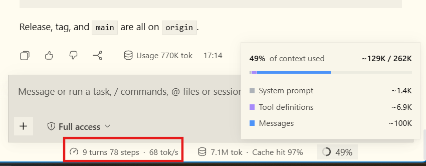

# Qwen3.8-Flash-Next on AMD Strix Halo (Halogen Flash Server)


Local inference can be intimidating at first. So many engines, so many models, each with a thousand different custom quants.

So we made a set of convenience scripts for running Qwen3.8-Flash-Next on a single Strix Halo machine through [Halogen Flash Server](https://github.com/peonist-ai/halogen-flash-server) — a [high-performance](#performance) inference engine by [Peonist.ai](https://x.com/high52weeks), custom-built for Qwen 3.8 Flash.

**The short-term goal** is to give you an *excellent* starting point for local inference on a fresh Fedora, Ubuntu, or Arch install on an AMD Strix Halo. No prior experience with running local AI models needed — the scripts guide you through every step.

**The long-term goal** is to make you so good at this that you don't need these scripts anymore (but feel free to keep using them if you prefer!)

## Quick start

> These instructions apply to 128 GB Strix Halo. If you have the 96 GB version, see [README-96GB.md](README-96GB.md) (experimental).

### Prerequisites

- AMD Strix Halo with 128 GB RAM
- 130 GiB free disk minimum
- `podman`, `python3`, Kernel 7.0 or newer (handled by script if missing)
- Arch Linux specific: `sudo` installed and configured (missing in minimal install)

### Set up and run

Clone the repo and run the setup

```bash
git clone https://github.com/claudejaune/Qwen3.8-Halogen-Flash-Strix-Halo
cd Qwen3.8-Halogen-Flash-Strix-Halo
./setup.sh
```

The setup script will ask you questions, configure your system accordingly, and download the weights (~122 GiB; resumes if interrupted). Once configured, just run the server:

```bash
./run.sh
```

To stop the server, press Ctrl-c from the same terminal, or run `./stop.sh`.

### What setup.sh asks you

- Network binding: `localhost` (default) or all interfaces (0.0.0.0)
- The port to run it on
- Vision on/off
- Parallel slots (maximum allowed concurrent requests)
- Weights directory (default `~/models/halogen-models`, preserved across re-runs)
- Optimized kernel boot params: offered when missing

### Updating

From inside the repo, run:

```bash
git pull
./refresh.sh
```

Offers to stop the server and guides you through the rest of the process.

#### Updating to a specific version

To update to a specific Halogen Flash version (e.g., to try versions newer than the pinned ones or roll back to an older version in case of a regression), run:

```bash
git pull
./refresh.sh --image 0.18.16
```

You can also pull the latest Halogen Flash version offered by upstream:

```bash
git pull
./refresh.sh --image latest
```

## Using with coding agents (Pi, OpenCode, etc)

Point your harness to the IP address, port (`http://127.0.0.1:8731/v1` by default), and API key you chose, or tell your agent to add it to your harness' models list. It should then appear as `Halogen Qwen 3.8 Flash` (or whatever you named it) in your list.

## Performance

Stable, sustained 65+ tok/s decode on multi-turn development on *real* codebases, without benchmark number trickery.



Need raw numbers anyway? Look at the [official stats](https://github.com/peonist-ai/halogen-flash-server#measured) or [benchmark it yourself](https://github.com/peonist-ai/halogen-flash-server#measuring-a-checkpoint) (and let us know what you find!) 

## Documentation

- [Environment flags](https://github.com/peonist-ai/halogen-flash-server/blob/main/docs/FLAGS.md): for advanced users
- [Troubleshooting](docs/troubleshooting.md): if you get stuck
- [How it works](docs/how-it-works.md): deets for nerds and clankers

## Credits

- Official Halogen Flash repo: [peonist-ai/halogen-flash-server](https://github.com/peonist-ai/halogen-flash-server). Halogen Flash is the real powerhouse. This repo is just a set of convenience scripts.

## License

- This repo: MIT — see [LICENSE](LICENSE)
- Halogen Flash: [EULA](https://github.com/peonist-ai/halogen-flash-server/blob/main/LICENSE.md)
